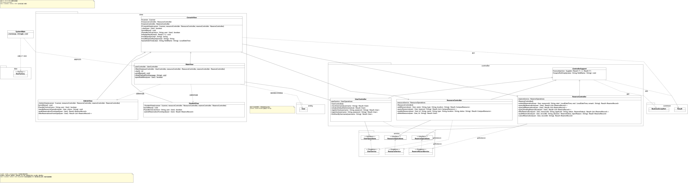

# Java-homework

[简体中文](README.md) | **English**

<!-- When editing this file, update README.md as well so that both languages reflect the same content and progress. -->

A campus resource reservation system developed for a comprehensive software construction practice course. This repository contains 20 iterative tasks, each in its own directory as an independent Java project. Each project builds incrementally on the previous one.

This page is available in Chinese and English. Task documentation and original course materials remain in Chinese.

Current status: Tasks 01–12 have passed user acceptance and their source has been committed. Task 13's original acceptance and commits remain recorded. As requested, Tasks 13 and 14 now follow the complete required package structure; both corrected versions have passed self-tests and await user acceptance. Tasks 15–20 are not yet implemented.

## Original Requirements

- [Course task list](项目任务列表.docx)
- [Grading criteria](评分标准.docx)
- [Requirements review and documented ambiguities](docs/需求核对.md)

## Repository Structure

Directories follow the `任务编号-版本-任务名` pattern (task number, version, and task name). Task numbers are padded with a leading zero for sorting, and colons in task titles are replaced with hyphens.

```text
Java-homework/
├── README.md
├── README.en.md
├── LICENSE
├── CONTRIBUTING.md
├── AGENTS.md
├── .gitignore
├── .gitattributes
├── .github/pull_request_template.md
├── 项目任务列表.docx
├── 评分标准.docx
├── docs/需求核对.md
├── 任务01-V1.0-项目初始化/
│   ├── README.md
│   └── src/
├── 任务02-V1.1-用户注册功能/
│   ├── README.md
│   └── src/
├── …
└── 任务20-V6.0-项目视图拓展/
    ├── README.md
    └── src/
```

The repository root contains Git metadata, course documentation, and local IntelliJ IDEA configuration for multiple modules. Each task directory contains its own source code, run instructions, and any configuration, tests, or documentation needed at that stage, without depending on other task directories. Run each program with its task directory as the working directory so that versions do not share persistence files.

As requested by the user on November 10, 2026, later stages also inherit existing application data, stored as an independent copy in the new task directory. Copy or merge compatible formats; convert and migrate data when the format or storage mechanism changes. Back up existing target data and check for conflicts first. Preserve any data that cannot be migrated and document the reason. Runtime data and backups remain excluded from Git. See the [data migration rules](AGENTS.md#阶段间持久化数据迁移).

Under the user's updated requirements, Tasks 03–08 organize Java packages by responsibility under `src/com/campus/reservation/`. The entry point stays in the root package. Task 03 introduces `entity`, Task 04 adds `util`, Task 05 adds `exception`, Task 06 extends this structure with resource management, Task 07 adds `Result` to `entity`, and Task 08 continues with the same package structure. Compilation and execution continue to use the JDK and existing scripts, without Maven or frameworks. Tasks 1 and 2 retain their original structure. The source of these decisions is recorded in the [requirements review](docs/需求核对.md).

Tasks 01–14 contain source code for their respective stages; Tasks 15–20 contain placeholders. Task 10 introduced UI / Service / DAO and UML, Task 11 completed reservation state transitions, Task 12 added singleton services and DAOs with a DAO factory, and Task 13 introduced View → Controller → Service → DAO. This correction adds the required enums and common packages and ReserveRecordService name to both Tasks 13 and 14. Task 14 provides four live Stream reports within the corrected MVC structure. Existing business rules and file formats remain compatible, and each task runs independently.

Tasks 03–14 provide OpenIDEA run configurations that work from the repository root or their respective task directories. Task 14 has its own copy of Task 13's 2 accounts, 4 resources and 1 reservation; see its README for migration details.

This local IntelliJ IDEA workspace contains independent modules and run configurations for Tasks 01–14; each uses its own task directory. The `.idea` configuration is local and ignored by Git. Task 14 was verified on the command line with JDK 8; its GUI run buttons await user verification.

Configuration fix recorded on November 10, 2026: IDEA previously loaded only an empty root module, retained incorrect Maven import settings, and lacked compilation steps before launch. The task modules were restored, the incorrect Maven configuration was removed, and SDK, output, and build settings were completed. The JPS project loader bundled with the local IntelliJ IDEA `2025.3.1.1` installation validated all 20 modules, with zero JPS compilation errors. The compiled output of Tasks 01–09 successfully started under JDK 17 in isolated working directories and used Java 8 bytecode. Hashes of 131 protected files, including source code, existing launch configurations, and application data, remained unchanged. IDEA automatically reindexed the modules; the GUI Run button still awaits user verification. The `.idea/` configuration, backups, and validation records are stored only on this machine and ignored by Git, so a fresh clone will not include them.

## Task Index

Tasks 01–12 have passed user acceptance and their source has been committed. Task 11 was committed as `05d8375`, followed by comment changes in `cfc1185`; Task 12's source commit is `4aa55d6`. Task 13's original source commit is `028a216`, with README updates in `ba1a743`. On November 11, 2026, the user accepted the original Task 13, then identified the missing package requirements and requested corrections to both Tasks 13 and 14. Both corrected versions have passed self-tests and await renewed user acceptance. No staging, commit or push was performed this round. Tasks 15–20 are not yet implemented.

| Task | Version | Project |
| --- | --- | --- |
| 01 | V1.0 | [Project initialization](任务01-V1.0-项目初始化/README.md) |
| 02 | V1.1 | [User registration](任务02-V1.1-用户注册功能/README.md) |
| 03 | V1.2 | [Object-oriented encapsulation: refactoring the User entity](任务03-V1.2-面向对象封装-User实体类重构/README.md) |
| 04 | V1.3 | [File persistence with Java I/O](任务04-V1.3-IO文件持久化功能开发/README.md) |
| 05 | V1.4 | [Custom exceptions](任务05-V1.4-自定义异常/README.md) |
| 06 | V2.0 | [Core campus resource management](任务06-V2.0-校园资源核心模块开发/README.md) |
| 07 | V2.1 | [A unified Result wrapper](任务07-V2.1-统一返回结果封装Result/README.md) |
| 08 | V2.2 | [Functional programming](任务08-V2.2-函数式编程/README.md) |
| 09 | V3.0 | [Core resource reservation features](任务09-V3.0-资源预约核心业务开发/README.md) |
| 10 | V3.1 | [Refactoring to a three-layer architecture](任务10-V3.1-三层架构重构/README.md) |
| 11 | V3.2 | [Reservation approval and state machine transitions](任务11-V3.2-预约审核流程与状态机流转开发/README.md) |
| 12 | V3.3 | [Engineering improvements](任务12-V3.3-工程优化/README.md) |
| 13 | V4.0 | [MVC architecture](任务13-V4.0-MVC架构/README.md) |
| 14 | V4.1 | [Advanced Stream operations for statistics and popularity rankings](任务14-V4.1-高阶Stream实现数据统计与热度排行/README.md) |
| 15 | V4.2 | [Automatic logging with custom annotations without modifying business logic](任务15-V4.2-自定义注解实现无侵入自动日志/README.md) |
| 16 | V4.3 | [Generic object utilities using reflection](任务16-V4.3-反射机制实现通用对象工具/README.md) |
| 17 | V5.0 | [Asynchronous tasks with thread pools and thread safety](任务17-V5.0-线程池异步任务与并发安全优化/README.md) |
| 18 | V5.1 | [Extending behavior with Adapter and Decorator patterns without modifying business logic](任务18-V5.1-适配器、装饰器模式业务无侵入拓展/README.md) |
| 19 | V5.2 | [Persistence layer refactoring: configuration-driven storage options](任务19-V5.2-持久层重构-配置驱动多存储方案/README.md) |
| 20 | V6.0 | [Additional user interfaces](任务20-V6.0-项目视图拓展/README.md) |

Task 18's title conflicts with its detailed requirements. The directory retains the original title for now; see the requirements review for the scope discussion.

Task 14 adds administrator menu options **9. Resource statistics, 10. TopN popular resources, 11. User statistics, 12. Global reservation status**. Reports are computed from current reservation states, preserve groups for deleted resources, and are unavailable to students. See the [Task 14 run and acceptance instructions](任务14-V4.1-高阶Stream实现数据统计与热度排行/README.md).

## UML Architecture Diagrams

Task 13's MVC class diagram follows **View → Controller → Service → DAO**. The native VPP, PlantUML and previews now reflect the corrected common / enums packages and service name. This preview was exported from Visual Paradigm 16.2; click to view it at full size. It represents Task 13 and does not include Task 14's added statistics DTOs or methods.

[](任务13-V4.0-MVC架构/docs/uml/vpp-preview/architecture.png)

- [All four UML diagrams and architecture evolution notes](任务13-V4.0-MVC架构/README.md#uml-交付物): View / Controller, Service / DAO / singletons / factory, entities and states, and exception inheritance.
- [Editable Visual Paradigm project (VPP)](任务13-V4.0-MVC架构/docs/uml/任务13-MVC架构.vpp) · [Main diagram SVG](任务13-V4.0-MVC架构/docs/uml/architecture.svg) · [PlantUML source](任务13-V4.0-MVC架构/docs/uml/architecture.puml).
- [Task 10 three-layer architecture UML](任务10-V3.1-三层架构重构/README.md): the original stage is preserved for comparison with MVC.

## Iteration Workflow

1. Develop tasks in numerical order, completing the current task and obtaining user acceptance before proceeding. Record actual test results.
2. When starting the next task, inherit the previous accepted task's source code and persistent application data, then make incremental changes. Back up data, verify compatibility, and convert it if necessary. Do not copy build output, machine-specific IDE settings, or unrelated local credentials.
3. Preserve completed task directories as records of each stage. Do not copy later features back into earlier tasks. Each task's change description records its additions, refactoring, and regression checks.
4. Keep Git history in the repository root; do not initialize nested repositories inside task directories. For an independent delivery, provide the complete task directory and its documentation.

## Development and Acceptance Constraints

- Use JDK 8 or later and plain Java without third-party frameworks. Task 1 must be verified with JDK 8 as specified in the assignment.
- Task 1 keeps all code in `SystemMain`. Under the user's confirmed requirements, Task 7 retains existing packages without adding architectural layers, which differs from the original requirement to avoid both packages and layers. A three-layer architecture is introduced in Task 10, followed by MVC in Task 13.
- The console version is the required baseline. Additional user interfaces in Task 20 are optional for bonus points and must not modify core business code.
- Tasks 10 and 13 deliver UML class diagrams for the three-layer and MVC architectures, respectively. Task 13 includes PlantUML, SVG / PNG, and a native VPP reopened and checked with Visual Paradigm 16.2, while preserving Task 10's diagrams. Final delivery includes source code, a project report, and a recorded demonstration.
- Runtime user, resource, reservation, and log files are ignored by Git. Demo data intended for version control belongs in each task's `samples/` directory, with loading instructions.
- Tasks 01–14 were independently compiled and run with JDK `1.8.0_341`. The corrected Tasks 13 and 14 passed package checks, business regression, state machine, console, 14 paired baseline sessions each, and existing-data compatibility checks. Task 14 also passed all four report regressions. Both corrected versions and IDE GUI buttons await user verification; see their READMEs. Tasks 15–20 are not yet implemented or tested.

## Grading

| Category | Points |
| --- | --- |
| Completion of iterative task features | 40 |
| Code quality and engineering practices | 20 |
| Architecture, design patterns, and design principles | 15 |
| UML modeling | 10 |
| Final documentation and demonstration | 15 |

The base score is 100 points. Additional user interfaces can earn up to 5 bonus points, and advanced persistence in Task 19 can earn up to 5 bonus points, for a total bonus of up to 10 points.

## Contributing

Contributions through Issues and Pull Requests are welcome. Read the [contribution guide](CONTRIBUTING.md) before starting for the development scope, environment conventions, self-testing and user acceptance process, and commit and PR requirements.

## Commits and Pull Requests

Commit messages and PR titles follow [Conventional Commits 1.0.0](https://www.conventionalcommits.org/en/v1.0.0/#specification), with descriptions written in Chinese, for example:

```text
feat(task01): 实现管理员和学生登录
fix(task02): 修复重复用户名校验遗漏的问题
refactor(task10): 完成三层架构重构
docs(task13): 更新 MVC 类图与运行说明
```

PR descriptions must be written in Chinese and explain the original problem, its cause, the solution, and the test methods and results. State which tests were not run and why. The template is available at [.github/pull_request_template.md](.github/pull_request_template.md).

## License

The code and documentation authored for this repository are licensed under the [MIT License](LICENSE), with the notice `Copyright (c) 2026 Felix-cy110`. Rights to third-party materials, including the original course assignment and grading criteria, remain with their respective owners; those materials are not relicensed by this license.
