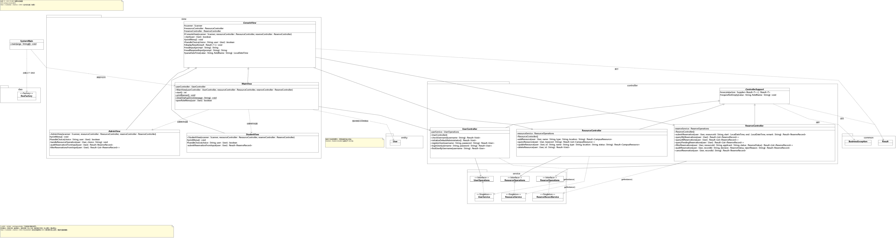
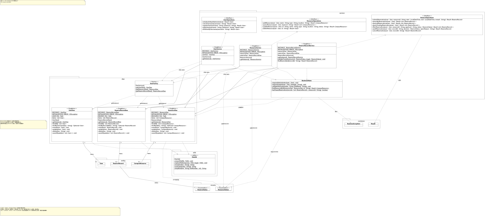
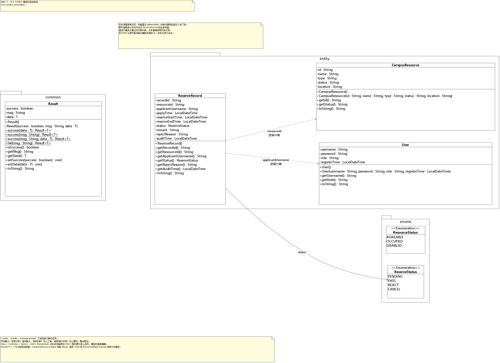
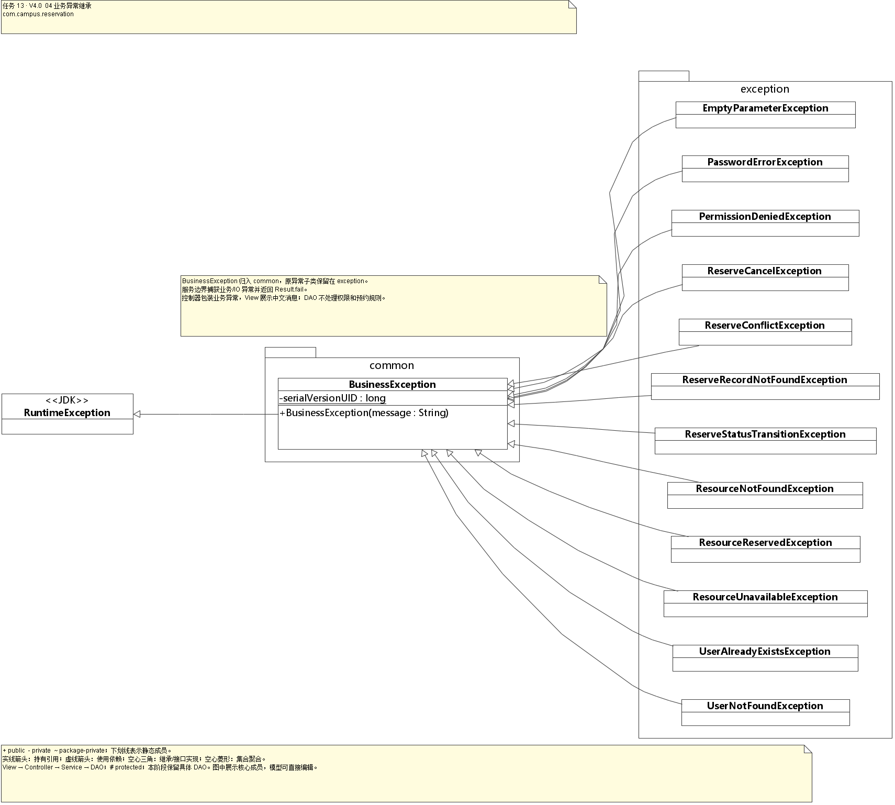

# 任务13 V4.0 MVC架构

状态：自测通过，待用户验收。2026-11-11 按用户要求重新落实任务 13 原文包结构，并同步任务 14；先前版本记录保留，本次修正版已重新自测，等待用户复测。

前置版本：[任务12 V3.3](../任务12-V3.3-工程优化/README.md)。本任务继承已验收源码及独立数据副本，在当前目录增量重构，可独立编译、运行。

完整要求见[项目任务列表](../项目任务列表.docx)，歧义记录见[需求核对](../docs/需求核对.md)。以下目标与验收摘自原文。

## 迭代目标

任务 10 完成了三层架构（Controller-Service-Dao），任务 12 引入单例 + 简单工厂管理实例。 本次迭代：基于现有三层架构，重构为 MVC 架构，清晰划分 Model、View、Controller 职责；同时更新 UML 类图，体现 MVC 的组件关系。

核心思想：分离视图展示、业务控制、数据模型，消除控制台输出散落在 Service/Dao 中的问题；业务逻辑、持久层代码不改动，只做职责与包结构调整。

## 验收标准（原文）

- 包结构严格按照 MVC 划分，View、Controller、Service、Dao 分层清晰；
- 控制台输入输出全部放在 View，Service/Dao 中不存在任何打印语句；
- 调用链路正确：View → Controller → Service → Dao；
- 原有全部业务功能正常运行，无 BUG；
- 提交更新后的 MVC 版本 UML 类图，依赖关系绘制正确；
- 代码没有跨层直接调用（View 禁止直接调用 Service/Dao）。

## 实现与测试记录

任务 12 的 `ConsoleUI` 同时承担登录、角色菜单和服务调用。任务 13 初版已拆出 View / Controller，但误将原文的完整包结构当成示意，遗漏了 `enums`、`common`、`ResourceStatus` 以及预约服务的规定名称；此前实现不完整，本轮按原文纠正。

本次以任务 12 已验收提交 `4aa55d6` 的业务规则为基线，在任务 13 原源码提交 `028a216`、文档提交 `ba1a743` 上增量修正：`ReserveStatus` 迁入 `enums`，`Result` 和 `BusinessException` 迁入 `common`，`ReserveService` 更名为 `ReserveRecordService`，新增并实际使用 `ResourceStatus`。Service / DAO 的调整限于包引用、类名和等值状态常量；控制器补充必填参数校验，不改变业务规则、状态机、单例工厂及持久化格式。

用户于 2026-11-11 确认保留具体 DAO，不提前抽取接口；图按实际实现绘制。用户同时要求交付可在本机 Visual Paradigm 16.2 编辑的 `.vpp`，保留任务 10 原工程。

| 必做要求 | 实现位置 | 验证与结果 |
| --- | --- | --- |
| MainView / AdminView / StudentView 与纯视图 IO | `view` | 分层检查及控制台回归通过，所有标准输入输出均在 View |
| 三个控制器，View → Controller → Service → DAO | `controller` | `MvcTest` 26 项、分层检查通过；View 不引用 Service / DAO |
| 原文完整包结构与类型名称 | `entity` / `enums` / `common` 及三层包 | 必需路径、package 声明、旧路径清除和枚举实际使用检查通过 |
| 业务、持久化、单例、工厂保持 | 继承 `service` / `dao` 等包 | 对任务 12 只归一必要包引用、类名、等值枚举常量及注释，余下业务源码一致；单例与业务回归通过 |
| 原有菜单、权限、状态机和错误恢复 | 当前任务 `tests` | 业务 103 项、状态机 108 项、控制台 30 项及 14 组前后版本会话通过 |
| 独立持久化数据迁移 | 本目录三个业务文件 | 2 个账号、4 条资源、1 条预约完整迁入；四次独立 JVM 校验通过 |
| MVC UML、可见性、依赖、单例和工厂 | `docs/uml` 中图源、预览、VPP | 已同步本轮包结构；41 个类型、199 个核心成员与编译后的源码一致；VP 16.2 原生重开、四图目视及无构建插件导出通过 |
| 三层 → MVC 演进说明与复测步骤 | 本 README | 已记录，下述手工步骤交用户验收 |

## 目录与职责

```text
src/com/campus/reservation/
├── SystemMain.java       启动加载、控制器和主视图装配
├── view/                 MainView、AdminView、StudentView、ConsoleView
├── controller/           UserController、ResourceController、ReserveController、ControllerSupport
├── service/              UserService、ResourceService、ReserveRecordService、Operations 接口及 BusinessRules
├── dao/                  原有具体 DAO 单例及 DaoFactory
├── entity/               User、CampusResource、ReserveRecord
├── enums/                ReserveStatus、ResourceStatus
├── common/               Result、BusinessException
├── exception/            继承 BusinessException 的原有异常子类
└── utils/                FileUtil
```

`ConsoleView` 复用输入流、菜单循环和统一结果展示；主视图处理登录注册及角色路由，角色视图只采集输入和展示结果。控制器接收参数、进行简单必填校验、调用服务，并通过 `ControllerSupport` 将业务异常转换为 `Result.fail`。权限、资源状态、预约冲突及状态流转仍由原服务判断。`SystemMain` 仅在启动时经 `DaoFactory` 加载三个文件，启动提示也委托 View 输出。

`ResourceStatus` 定义 AVAILABLE / OCCUPIED / DISABLED，并用于资源校验、文件读取及审核取消时的资源状态赋值。为保持原实体 API 与已有文件兼容，`CampusResource.status` 仍为 String，边界使用枚举的 `name()`；预约状态字段仍为 `ReserveStatus`。这两个状态枚举均属于 `enums`，并非未接入业务的空类型。

本阶段继续使用 JDK 和脚本，不引入 Maven、Spring Boot 或额外实现层。源码新增和调整处均保留精简中文注释。本轮按用户明确要求同步修正任务 14；任务 13 不包含任务 14 的统计功能，未实施选做视图或任务 15。

## 三层架构到 MVC 的演进

| 关注点 | 任务 10 的三层架构 | 任务 13 的 MVC |
| --- | --- | --- |
| 交互与调度 | `ui.console.ConsoleUI` 同时处理输入、菜单、结果展示和服务调用 | `view` 负责交互，`controller` 负责请求转发与结果边界 |
| 业务调用方向 | UI → Service → DAO | View → Controller → Service → DAO |
| 模型 | 实体、统一返回、异常及业务数据 | 实体在 entity，状态在 enums，Result / BusinessException 在 common；Service / DAO 支撑模型业务与持久化 |
| 实例管理 | 按任务 10 当期方式创建对象 | 继承任务 12 的 Service / DAO 饿汉单例和 DaoFactory；控制器取得服务单例，服务经工厂取得 DAO |
| 视图替换 | 控制台交互和服务调用集中于 ConsoleUI | 新视图可复用控制器；业务服务和文件格式无需随界面调整 |

此次拆分用于落实单一职责，控制器通过已有 Operations 接口持有服务，保留原来的面向接口调用，并落实原文指定包与服务类名。DAO 接口仍按用户已确认口径留到任务 19，当前图展示真实具体 DAO。任务 10 的 UML 原文件保留，任务 13 的 MVC 工程同步修正。以上真实演进记录供任务 20 的实践报告复用，本阶段不另交 Word / PDF 报告。

## 运行与用户验收

本机使用 Oracle JDK `1.8.0_341`，路径 `D:\jdk8`。在本任务目录运行：

```powershell
.\run.ps1 -JdkHome 'D:\jdk8'
```

可将路径换成本机实际 JDK；已配置 `JAVA_HOME` 时可直接运行 `.\run.ps1`。从仓库根目录运行：

```powershell
powershell.exe -NoProfile -ExecutionPolicy Bypass -File '.\任务13-V4.0-MVC架构\run.ps1' -JdkHome 'D:\jdk8'
```

OpenIDEA 打开仓库或本任务目录，选择 **任务13：编译并运行**；本机 IntelliJ IDEA 可选择 **任务13-V4.0-MVC架构：运行**，入口为 `com.campus.reservation.SystemMain`，模块为 `task13`，工作目录为本任务目录。本机 `.idea` 配置被 Git 忽略；两种 IDE 的图形运行按钮未代为点击，需用户复测。编译运行脚本已通过 Windows PowerShell 5.1 验证。

正式数据为本目录 `user.txt`、`resource.txt`、`reserve.txt`。现有账号继续使用原密码；首次缺少管理员时沿用 `admin / 123456`，普通注册仍为 `student`。既有管理员不会被重置。

建议按以下顺序复测，操作会写入任务 13 自己的数据：

1. 启动后确认标题为 V4.0；先输入无效选项，再输入错误密码，预期提示失败且返回菜单。
2. 用原管理员登录，查询迁入资源及全部预约；用原学生登录，查询可用资源和自己的预约。预期原数据可见，两个角色菜单不同。
3. 管理员新增一条测试资源，记下 ID；学生提交预约，时间示例 `2030-01-02T10:00` 至 `2030-01-02T11:00`。预期状态为 PENDING。
4. 管理员审核 PASS，预期资源为 OCCUPIED；学生取消自己的该预约，预期状态为 CANCEL，并按原业务规则释放资源。REJECT / CANCEL 不能再次取消，已处理记录不能重复审核。
5. 退出到首页再输入 `0`，重新运行后查询，预期本次记录仍在；任务 12 数据不随任务 13 改动。
6. 在指定 Visual Paradigm 16.2 中使用“打开工程”打开下方 VPP，检查四张图及 View → Controller → Service → DAO 的关系，类和方法可以直接编辑。

`samples/` 是演示数据，供隔离自测使用；不要覆盖迁入的正式数据。独立编译运行只需要本任务源码和 JDK；测试脚本额外使用 Python，前后版本差异比较还会只读编译仓库中的任务 12 源码。

## 数据迁移记录

2026-11-11，从任务 12 的三个业务文件迁入 2 个账号、4 条资源、1 条预约。源目标编码、字段、ID 和格式一致，采用完整复制；目标原先无业务文件，无冲突、无未迁移项。账号、资源 ID、预约时间、状态及关联保持原值；终态预约允许保留已删除资源的历史 ID，不据此丢弃记录。

迁移前确认应用已退出，源文件及目标原状备份在本机忽略目录 `data/migration-task12-761cc7d8b0db4d358acaf7da2a470ab1/`（`source/`、`target/`、`validation/`）。先在隔离副本进行两次独立 JVM 登录、查询及关联校验，写入目标后再独立启动两次；每次 8 项检查均通过。迁移后启动正式运行脚本并退出成功，源文件保持不变。备份和运行数据不纳入 Git。

本地迁移脚本 `data/migrate-task12.ps1` 重跑相同数据不会重复导入；目标内容不同时拒绝覆盖，避免丢失新记录。本次交付后用户使用迁入的独立数据验收，不再自动用旧任务文件覆盖。

本轮包结构修正未改变数据格式，也未重新覆盖正式文件。修改前备份于 `data/package-rework-c8905800d4564bc1ba79fec474c6fa2d/`；在新的隔离副本中两次独立 JVM 验证加载、登录、查询及关联，每次 8 项通过，仍为 2 个账号、4 条资源、1 条预约。从根目录与任务目录启动退出后，三个正式文件的哈希均与修正前一致。无冲突或未迁移项。

## UML 交付物

原生工程：[任务13-MVC架构.vpp](docs/uml/任务13-MVC架构.vpp)。请使用用户指定的 `D:\Visual Paradigm 16.2\Visual Paradigm 16.2\Visual Paradigm 16.2\bin` 中的 Visual Paradigm 16.2 打开，避免默认文件关联调用其他版本。

| 图 | 可编辑图源 | SVG | PNG | 原生 VPP 导出预览 |
| --- | --- | --- | --- | --- |
| View 与 Controller | [architecture.puml](docs/uml/architecture.puml) | [查看](docs/uml/architecture.svg) | [查看](docs/uml/architecture.png) | [查看](docs/uml/vpp-preview/architecture.png) |
| Service、DAO、单例与工厂 | [services.puml](docs/uml/services.puml) | [查看](docs/uml/services.svg) | [查看](docs/uml/services.png) | [查看](docs/uml/vpp-preview/services.png) |
| 实体、状态与统一返回 | [models.puml](docs/uml/models.puml) | [查看](docs/uml/models.svg) | [查看](docs/uml/models.png) | [查看](docs/uml/vpp-preview/models.png) |
| 业务异常继承 | [exceptions.puml](docs/uml/exceptions.puml) | [查看](docs/uml/exceptions.svg) | [查看](docs/uml/exceptions.png) | [查看](docs/uml/vpp-preview/exceptions.png) |

以下预览均由上述 VPP 工程导出，与可编辑工程对应。点击图片可查看原尺寸；主图和服务图较宽，可使用表中的 SVG 放大查看文字。

<!-- 更新 VPP 图时，同步导出以下四张预览，保持 README 与工程一致。 -->

### 图 1：View 与 Controller

展示入口装配、视图与控制器的职责及依赖，调用方向为 **View → Controller → Service**，服务到 DAO 的关系见图 2。

[](docs/uml/vpp-preview/architecture.png)

### 图 2：Service、DAO、单例与工厂

展示服务接口、服务与具体 DAO 的关系，以及单例实例和 `DaoFactory` 的依赖。

[](docs/uml/vpp-preview/services.png)

### 图 3：实体、状态与统一返回

展示 `entity` 的三个实体、`enums` 的两个状态枚举及 `common.Result<T>` 的属性、方法与关系；资源实体的文本状态兼容方式在图例说明。

[](docs/uml/vpp-preview/models.png)

### 图 4：业务异常继承

展示 `common.BusinessException` 与 `exception` 中业务异常子类的继承关系及可见性。

[](docs/uml/vpp-preview/exceptions.png)

图中展示核心属性和方法、参数及返回类型、可见性、静态成员、抽象成员、依赖与关联、包边界和调用方向。`Result<T>` 保留泛型模型；Service 和 DAO 标注单例，DaoFactory 标注工厂。主图较宽，建议用 SVG 或在 VPP 中缩放查看。任务 10 的原图未被覆盖。

本轮实际核对：41 个类型（40 个项目类型及 JDK `RuntimeException`）、199 个核心成员的签名和修饰符经编译产物反射核对；VPP 使用原生类、属性、方法、包、关系和注释模型，保存后在独立的 VP 16.2 进程中重开，检查四张图、成员、包归属、图形边界和 69 个去重关系。原生图的包使用透明填充并保留边界，避免 VP 16.2 导出时包背景遮挡类框。

本轮 PlantUML 与 VPP 的四图均已渲染、目视检查；主图 PNG 解除默认宽度限制，未截断右侧控制器和 common 包。移除临时构建插件后，两次独立导出的四张原生 PNG 逐像素相同，交付工程不依赖构建插件。README 使用带白色背景的 VP 原生导出，避免透明图在深色主题下难以辨认。主图较宽，原尺寸或 SVG / VPP 缩放查看可辨认成员。

## 实际自测记录

2026-11-11，在本任务目录执行：

```powershell
.\test.ps1 -JdkHome 'D:\jdk8'
```

| 检查 | 实际结果 |
| --- | --- |
| JDK 8 独立编译运行 | 通过；`javac -encoding UTF-8 -Xlint:all` |
| `SingletonTest` | 15 项通过，包含私有构造、实例身份及加载一次 |
| 三个文件分别损坏后的启动 | 均提示对应文件并返回退出码 1 |
| `RegressionTest` | 103 项通过，含注册登录、权限、资源、预约、写入失败与恢复 |
| `StateMachineTest` | 108 项通过，含状态矩阵、审核、取消、越权和回滚 |
| `MvcTest` | 26 项通过，含控制器转发、统一结果、角色权限和异常边界 |
| `verify-cli.py` | 7 个控制台会话、30 项检查通过 |
| `verify-mvc.py` | 167 项通过，含完整目录契约、业务源码归一比较、层次边界、14 组任务 12 / 13 配对会话；比较退出码、输出及三个持久化文件 |
| 现有数据兼容验证 | 本轮隔离副本两次独立 JVM，每次 8 项通过；原始迁移记录保留 |
| Windows PowerShell 5.1 正式脚本 | 从根目录和任务目录分别启动，显示 V4.0，输入 `0` 正常退出 |
| 历史成果与数据保护 | 本轮 181 个受保护文件哈希一致，含任务 01–12 源码、历史 UML 及任务 13 / 14 正式数据 |
| 启动配置 | 根目录及本任务 OpenIDEA TOML、本机 IDEA XML 均可解析；IDE 图形按钮待用户复测 |
| 文档链接 | 根中英文 README、两任务 README 及需求核对共 112 个本地链接检查通过 |
| UML | 编译产物反射核对、VP 16.2 原生重开、四图目视及移除构建插件后的独立导出均通过 |

测试使用 `data/` 下的隔离目录，未覆盖正式业务数据。动态 UUID、运行时间及版本号在前后版本比较时归一，其他提示和状态均参与比较。新增源码、运行配置、测试与 UML 均留在当前工作区供验收，本轮未暂存、提交或推送。

验收历史：用户于 2026-11-11 确认过任务 13 初版；随后指出包结构不符合原文并要求任务 13 / 14 重做，原确认不覆盖本轮修正版。本轮用户验收待反馈，IDE 图形运行按钮需重新复测，助手未代为点击。

[返回任务索引](../README.md)
